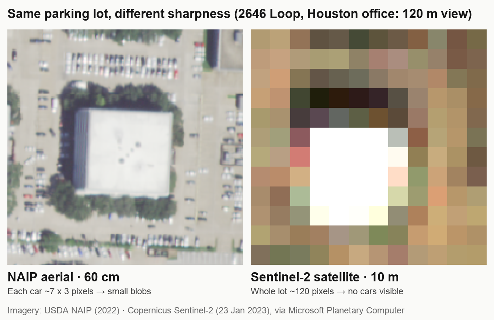

# Why aerial, not satellite

Free satellite imagery comes every ~5 days, against Vexcel's ~1 flight a year. So before building on 7.5 cm
aerial imagery we tested whether satellites could do the job. They can't: **at 10 m a car is a tenth
of a pixel, and the cars' effect on the lot's colour is about 6x smaller than everyday noise.**



| Source | Pixel | One car is | Count cars? | Free? |
|---|---|---|---|---|
| **Vexcel aerial** (our source) | 7.5 cm | ~60 x 24 px | **Yes**, sam3 detector | Hackathon licence |
| NAIP aerial (USDA) | 60 cm | ~7 x 3 px | Roughly; needs our own detector | Yes, every 2 yrs |
| Commercial satellite (Maxar, Pléiades Neo, SkySat) | 30-50 cm | ~15 x 6 px | Yes | No, paid, days to order |
| **Sentinel-2** (ESA) | 10 m | < 0.1 px | **No** (tested below) | Yes, every ~5 days |
| Sentinel-1 radar | 10 m | < 0.1 px | No: passes Houston at 6:23 AM / 6:27 PM, when office lots are empty anyway | Yes |

## Test 1: one office lot, 2018-2026 (`office_lot_test.py`)
2646 Loop, Houston: the lot ring on **438 clear Sentinel-2 scenes**. If the satellite could see cars,
a full weekday lot should look different from an empty weekend lot.

| | |
|---|---|
| Full (weekday) minus empty (weekend) brightness | **-1.8%** |
| Photo-to-photo noise (sun, shadow, haze, wet pavement), season removed | **10.3%** |
| Photos per period needed to see a full lot empty out | ~500 (we get ~28 clear weekdays a year) |
| ... to see a 30% emptying (a tenant leaving) | ~5,500 |
| Weekday brightness pre-COVID vs Apr 2020 - Jun 2021 (offices empty) | 0.154 vs 0.156: no change |

A matched check gives the same answer. Sentinel-2 on Sat 1 Feb 2020 (Vexcel: lot empty, 14 cars) reads
0.134; Mon 23 Jan 2023 (Vexcel: lot full, 124 cars) reads 0.128-0.132.

## Test 2: the Houston Rodeo (`rodeo_test.py`)
The strongest positive control available: NRG Park's lots, packed daily for ~3 weeks every Feb-Mar.
118 clear Jan-Apr scenes, 2018-2026; 24 during the Rodeo, 62 normal days in the same season. Lot
brightness is divided by the NRG Center roof to cancel haze and sun.

| Lot | What it is | Brightness, Rodeo vs normal | Texture, Rodeo vs normal |
|---|---|---|---|
| D, E | carnival / livestock grounds | **+14-17%** (t = +3.4, +4.8) | **2.4x** (t = +12, +14) |
| A, B, C, F | plain parking | -8% to +2% (t = -2.0 to +0.6) | flat or lower |

The satellite clearly sees the Rodeo, but the **tents, rides and barns**, not the cars. Lot C even
lights up days *before* opening, during set-up (20 Feb 2024, 26 Feb 2025). The lots that only hold
cars barely move.

**Conclusion:** satellite imagery is useful for big physical changes (construction, events, floods),
not for how full a parking lot is. Hence Vexcel's 7.5 cm imagery, where each car is a countable object.
The same analysis would carry over to daily 30-50 cm commercial satellites if they become affordable.

## Run it
No keys needed: Sentinel-2 and NAIP come from Microsoft Planetary Computer.
```bash
cd satellite
pip install -r requirements.txt
python office_lot_test.py --cached   # re-print from results/*.csv (drop --cached to re-download, ~15 min)
python rodeo_test.py --cached
python comparison_image.py           # -> results/comparison_public.png
python comparison_image.py --vexcel path/to/vexcel.jpg   # 3-panel slide version -> private/ (git-ignored)
```
Vexcel imagery is licensed for the event only, so it is never committed. The 3-panel version with the
Vexcel photo goes to `private/` for slides.
